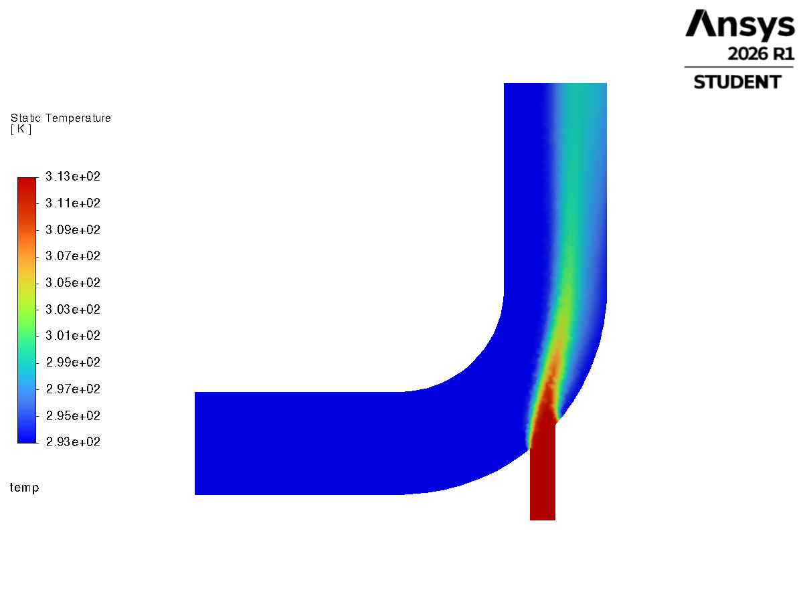
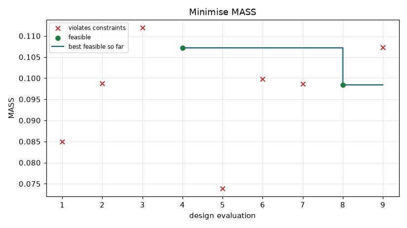

# Claude × Ansys: FEA and CFD from plain English

**Describe a part, its loads and what you need to know. Claude builds the model, runs it in *your*
Ansys install and verifies the answer. It reports back with numbers, plots and a report you can hand to a reviewer.**

An open-source MCP connector and Claude Code plugin for **Mechanical APDL, Mechanical, Fluent and
Workbench**. It adds parametric CAD, design optimisation and engineering reports, and it works with the free
Ansys Student edition.

[](LICENSE)


<table>
<tr>
<td width="33%"><br><sub><b>Structural:</b> motor bracket, 500 N shock + gravity (MAPDL)</sub></td>
<td width="33%"><br><sub><b>CFD:</b> hot/cold mixing elbow, energy balance exact (Fluent)</sub></td>
<td width="33%"><br><sub><b>Optimisation:</b> lightest bracket that clears the resonance band</sub></td>
</tr>
</table>

## Ask it things like

> *"Here's my bracket as a STEP file. Bolted at the two holes, 300 N on the tab. What's the safety factor, and is the first mode clear of a 50 Hz motor?"*
>
> *"Make this L-bracket as light as possible with SF ≥ 2 and the first two modes outside ±20 % of 60 and 120 Hz. Give me the STEP of the result."*
>
> *"Pressure drop through a 10 mm pipe, 300 mm long, water at 0.5 L/min. Laminar or turbulent? Check it against theory."*
>
> *"Write it up as a report I can send to my lead."*

## Why this connector

**Answers are checked, not just computed.** Every analysis skill is benchmarked against a closed-form or
published solution, and the skills make Claude verify its own work before reporting:
- equilibrium
- a hand calculation
- mesh convergence
- singularities flagged rather than reported as stress

| Benchmark | Error vs theory |
|---|---|
| Cantilever deflection, modal f1, Euler buckling (MAPDL) | 0.0 – 0.5 % |
| Heat conduction, restrained thermal stress (MAPDL) | exact |
| Harmonic resonance peak, 2× step-load amplification (MAPDL) | 0.3 %, 0.65 % |
| Static and modal in Workbench-hosted Mechanical (CAD import) | 0.03 %, 0.3 % |
| Fluent mixing elbow: mass balance / outlet temperature | 0.0006 %, exact |
| CAD → Fluent laminar pipe flow vs Hagen–Poiseuille (tet mesh) | Δp +6 %, u<sub>max</sub> −2 % |
| CAD → gmsh → MAPDL vs native MAPDL bracket | < 0.8 % |

**One pipeline from idea to deliverable:**
1. **Parametric CAD** (CadQuery): real fillets and holes, STEP export, and every face labelled in a picture so Claude picks faces by ID.
2. **Meshing** for structures (quadratic tets into MAPDL) or fluids (native Fluent mesh with named inlet, outlet and wall zones).
3. **Solving** in MAPDL, Mechanical, Fluent or a Workbench project you can open yourself.
4. **Optimising:** whole batches of design variants per call, with constraints and a progress chart.
5. **Reporting:** a calc-sheet report in HTML and Word with a verification table and sign-off block.

**Cheap to run.** Every tool call re-sends the conversation, so the connector does as much as possible
per call:
- **MAPDL:** one `mapdl_run` builds, solves and returns values and plots.
- **Replies:** errors, warnings and the numbers you asked for only, so MAPDL replies dropped from ~7,000 to ~200 characters.
- **Images:** 800 × 600, about 650 tokens each.

**Safe with licences.** Every solver dies with the connector, even when the client crashes. Orphaned
Ansys processes never sit on your licence.

**Honest about limits.** The [lessons file](docs/LESSONS.md) lists every pitfall found in testing and how it's handled.

## Install

**Claude Code** (connector and skills):
```
/plugin marketplace add PrachishD/Claude-ANSYS-skill
/plugin install ansys-connector@ansys-connector
```
Then ask *"Check my Ansys setup"*. Claude runs `ansys_status` and reports the install and licence it found.
CAD and optimisation need one extra download (CadQuery + gmsh): ask Claude to run `cad_install`, or run
`uv sync --extra cad` in `server/`.

**Any MCP client** (Claude Desktop, etc.):
```json
{
  "mcpServers": {
    "ansys": {
      "command": "uv",
      "args": ["run", "--directory", "/path/to/Claude-ANSYS-skill/server", "ansys-connector"]
    }
  }
}
```
For Claude Desktop, also upload the folders in `skills/` as zips under *Settings → Capabilities → Skills*.

## What's inside

| Area | Tools | Driven with |
|---|---|---|
| Mechanical APDL | `mapdl_run` (auto-starts; `get=`, `plots=`), `mapdl_get_parameters`, `mapdl_plot`, `mapdl_start`, `mapdl_stop` | APDL |
| Mechanical | `mechanical_run` (`images=`), `mechanical_export_image`, `mechanical_start`, `mechanical_stop` | Mechanical Python (ExtAPI) |
| Fluent | `fluent_run` (`images=`), `fluent_save_image`, `fluent_start`, `fluent_stop` | PyFluent settings API / TUI |
| Workbench | `workbench_start`, `workbench_run`, `workbench_open_mechanical`, `workbench_open_fluent`, `workbench_stop` | Workbench journals |
| CAD and meshing | `cad_build` (structural), `cfd_mesh` (fluid domain → Fluent mesh), `cad_install` | CadQuery + gmsh |
| Design studies | `design_evaluate` (batch of designs in one call, history, best-so-far chart) | CadQuery + MAPDL |
| Reports | `report_create` (HTML + Word) | structured study content |
| General | `ansys_status`, `show_image` | |

| Skill | What Claude learns | Verified against |
|---|---|---|
| `ansys-simulation` | product choice, token economy, pitfalls, verification checklist | |
| `static-structural` | stress, deflection, reactions, safety factor | Euler–Bernoulli; its own example runs verbatim in the tests |
| `modal-analysis` | frequencies, mode shapes, lumped masses with inertia | cantilever f1 |
| `buckling-analysis` | eigenvalue and nonlinear buckling | Euler column |
| `thermal-analysis` | steady and transient conduction, convection, thermal stress | 1D conduction, σ = EαΔT |
| `dynamic-response` | harmonic and transient response | resonance peak, 2× amplification |
| `workbench-mechanical` | Workbench projects, CAD import, Mechanical scripting | cantilever static and modal |
| `fluent-cfd` | fluid domains from CAD, setup, convergence, reports | mixing-elbow conservation, Poiseuille |
| `design-optimization` | parametric CAD, batch search, constraints | CAD route vs native MAPDL |
| `engineering-report` | calc-sheet reports with verification | motor-bracket study |

## Worked examples

- **[Motor mounting bracket](examples/motor-bracket):** a static and modal check with its report. Every check passed, then a realistic
  motor inertia moved mode 2 to 9.5 % from twice running speed. It shows why the skills insist on stating assumptions.
- **[Bracket optimisation](examples/bracket-optimization):** the same bracket rebuilt as parametric CAD and optimised to the
  lightest design that passes stress and both resonance constraints. Includes the winning STEP file.

## Eval

[`eval/`](eval) holds 24 engineering problems with independently derived answers (16 advanced: NAFEMS LE1,
free-free modes, lumped masses, fins, transient and harmonic dynamics, two-constraint sizing, a singularity trap, Fluent,
and pipe flow from CAD). The runner drives **real Claude Code** headlessly with only this plugin loaded and
grades the structured answers. The grader is self-tested; a published full-run score is the next milestone,
and contributions of runs are welcome.

## Requirements

- **Ansys 2024 R2 or newer** (Mechanical APDL, Mechanical, Fluent, Workbench), including the free
  [Ansys Student](https://www.ansys.com/academic/students) edition. Installs are found through `AWP_ROOTxxx` or
  the standard install folders.
- **Python 3.12+** and **[uv](https://docs.astral.sh/uv/)** (`pip install uv`). Dependencies install on first start.
- **Platform:** Windows is tested. Linux should work for MAPDL, Mechanical and Fluent; Workbench automation is Windows-first.
- **Windows paths:** keep the clone in a short path (e.g. `C:\dev\Claude-ANSYS-skill`) or
  [enable long paths](https://learn.microsoft.com/windows/win32/fileio/maximum-file-path-limitation).

| Optional variable | Purpose |
|---|---|
| `ANSYS_ROOT` | Ansys version folder, if auto-detection picks the wrong one |
| `ANSYS_MAPDL_EXEC`, `ANSYS_MECHANICAL_EXEC`, `ANSYS_FLUENT_EXEC` | explicit executables |
| `ANSYS_WORKDIR` | where runs are written (default `~/ansys_runs`) |

## Good to know

- **Ansys Student limits:**
  - Structural and thermal models: 128k nodes. Fluent: 1M cells.
  - Standalone Mechanical can't solve on Student, so the skills route Mechanical solves through Workbench.
- **CFD meshes:** `cfd_mesh` makes tetrahedral meshes with wall refinement. That's good for laminar flow and wall-function
  turbulence. For resolved boundary layers (y+ ≈ 1), use Fluent meshing or a Workbench Fluid Flow system.
- **Security:** `fluent_run` and the CAD tools execute Python in the connector process, and every tool runs solver input on
  your machine. Only use the connector with clients and models you trust.
- **Responsibility:** results are only as good as the model. Claude verifies its work and flags assumptions, but engineering judgement
  and sign-off stay with a qualified engineer.

## Tests

```
cd server
uv run python tests/test_mapdl_benchmarks.py   # 7 checks vs closed-form, incl. a skill example run verbatim
uv run python tests/test_workbench.py          # Workbench + Mechanical static & modal, image in the same call
uv run python tests/test_fluent.py             # Fluent mixing-elbow conservation
uv run python tests/test_design.py             # CAD -> mesh -> MAPDL optimisation study (needs --extra cad)
uv run python tests/test_report.py             # report rendering
uv run python tests/test_cleanup.py            # no orphaned Ansys processes after a client crash
```
These launch real solvers on your licence. The full suite takes about 45 minutes.

See [CHANGELOG.md](CHANGELOG.md) for what changed in each release.

## Disclaimer

Not affiliated with, endorsed by or supported by Ansys, Inc. or Synopsys, Inc. "Ansys", "Fluent",
"Mechanical" and "Workbench" are trademarks of their respective owners. This project only automates software
you have installed and licensed yourself. MIT licensed.
