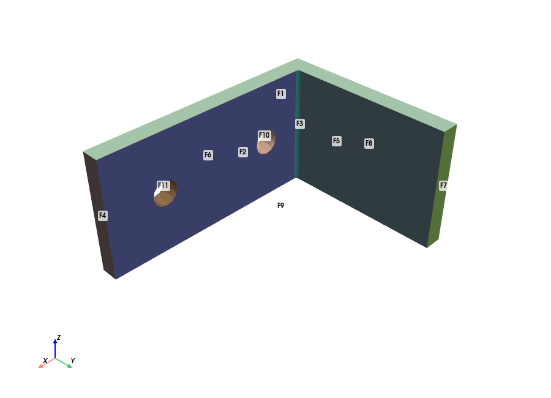

# Example: optimise the motor bracket (CAD -> gmsh -> MAPDL)

The [motor bracket](../motor-bracket) failed its resonance check: with a realistic motor inertia, mode 2
sat at 131 Hz, inside the ±20 % band around 2x running speed (120 Hz). This study makes the bracket a real
parametric CadQuery part, with an inner-corner fillet, and searches for the lightest design that passes.

**Design variables:**
- plate thickness `T`
- width `W`
- inner-corner fillet radius `FIL`

**Objective:** minimise mass.

**Constraints:**
- von Mises ≤ 138 MPa (SF ≥ 2 on 276 MPa yield, bolt-bore rings excluded)
- mode 2 ≥ 144 Hz
- mode 1 ≤ 96 Hz

Each evaluation runs CadQuery geometry → STEP → gmsh quadratic tets → MAPDL static (500 N + gravity) and modal
(1.2 kg motor, 1 t·mm² rotary inertia). That's about 10 s per design, and one `design_evaluate` call per batch.

| | T × W × FIL (mm) | Mass | σvm | f1 | f2 | |
|---|---|---|---|---|---|---|
| Baseline | 6 × 40 × 1 | 0.085 kg | 201 MPa | 77.2 Hz | 131.9 Hz | fails stress and f2 |
| **Best found** | **6 × 46 × 4** | **0.098 kg** | **118 MPa** | **84.7 Hz** | **145.1 Hz** | **passes all** |

- `best_design.step` is the winning geometry.
- `history.csv` holds all nine evaluations.

The search is a short scripted DOE plus one refinement step, so a Claude-driven search should do better. Evaluation 5
(T = 7, W = 30, FIL = 6) reached 0.074 kg and missed f2 by only 1.4 Hz.

Reproduce with `uv run python tests/test_design.py` from `server/` (needs `uv sync --extra cad`).
