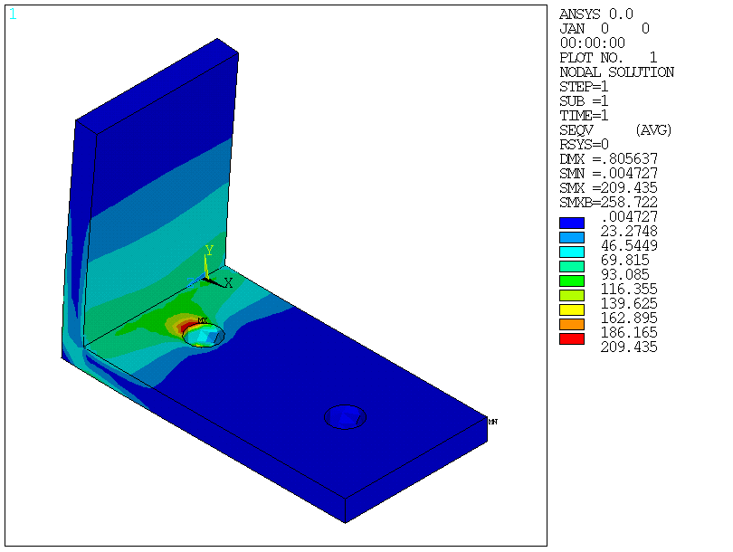
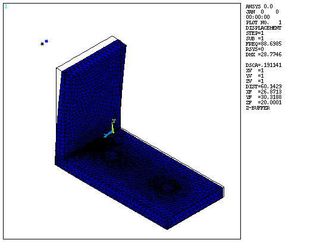
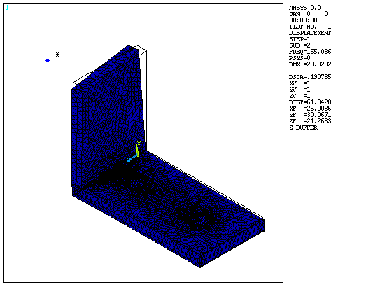
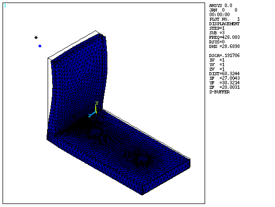
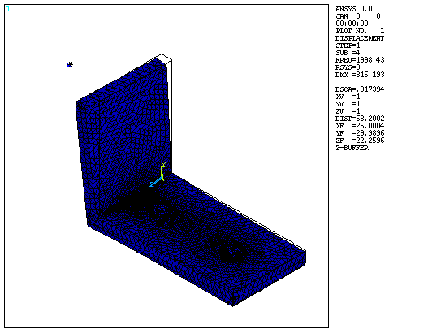

# Example: motor mounting bracket (static + modal)

A worked study run through the connector in Claude Code and then checked independently. It shows
the workflow and what the verification step catches.

## The prompt

> L-bracket, aluminum 6061-T6, 6 mm plate, 40 mm wide. Base 80 mm along X, bolted through two
> Ø8.5 mm holes at X = 20 and 60 mm (fixed bores, underside free). Upright 60 mm tall at X = 0.
> A 1.2 kg motor centred 50 mm up, 30 mm out from the upright's outer face, attached to a 20×20 mm
> patch. Static: 500 N horizontal shock toward the base plus gravity. Modal: first 4 modes,
> motor at 3600 rpm. Report stress, safety factor, deflection, bolt reactions, frequencies and
> resonance risk, with a mesh convergence check.

## Model

[`bracket.mac`](bracket.mac) is the APDL Claude wrote, lightly cleaned up. Run it with:
```
*USE,bracket.mac,<global size>,<local size>,<1 static | 2 modal>,<motor rotary inertia t*mm^2>
```
- **Elements and units:** SOLID187 tets, mm-N-MPa-tonne.
- **Mesh refinement:** around the bores and the inner corner.
- **Motor:** a MASS21 point mass tied to the patch with RBE3.

## Results (2 mm global / 1 mm local mesh)

| Quantity | Value | Check |
|---|---|---|
| Max von Mises, away from singular spots | 135 MPa, base top between the corner and bolt 1 | Converged within 0.5% on refinement |
| Safety factor vs 276 MPa yield | ≈ 2.0 | |
| Upright root stress, 3 mm above the corner | 78 MPa | Hand calc M·c/I ≈ 85 MPa |
| Max deflection | 0.81 mm (top of the upright) | |
| Bolt reactions, X | 467 N + 33 N | Sum is 500 N (equilibrium) |
| Bolt reactions, Y | +95 N / −107 N | Net −12.6 N = motor plus bracket weight |



**Bolt-hole note:** the raw peak (200–300 MPa, still rising with refinement) sits where a *fully fixed* bore meets a free surface. That's a modelling singularity, so it was excluded. Real bolts in clearance holes behave differently: the bracket rocks and puts roughly 400–600 N of tension into bolt 1. Size the bolts from that, and model washers and floor contact before trusting stresses right at the holes.

## Modal and resonance: why the motor's inertia matters

| Motor model | Mode 1 | Mode 2 | Mode 2 vs 2× running speed (120 Hz) |
|---|---|---|---|
| Point mass, no rotary inertia (Claude's run) | 88.8 Hz | 156.1 Hz | +30%: looks safe |
| **Realistic inertia, ≈ 1 t·mm² (Ø80 mm motor)** | **76.5 Hz** | **131.4 Hz** | **+9.5%: resonance risk** |

Mode 2 is the motor swaying sideways while the upright twists. The original run modelled the motor as a pure point mass. It flagged that this could under-predict the drop, but its headline said nothing resonates. Adding a realistic rotary inertia, as below, puts mode 2 inside the ±20% band around 2× running speed. **Verdict: the bracket needs stiffening** (a corner gusset or a thicker or wider upright), or a bump test to measure the real frequency.

```
*USE,bracket.mac,2,1,2,0      ! point-mass motor   -> 88.8 / 156.1 Hz
*USE,bracket.mac,2,1,2,1.0    ! realistic inertia  -> 76.5 / 131.4 Hz
```

| | | | |
|---|---|---|---|
|  |  |  |  |

*The mode plots come from the point-mass run.*

## Lessons

- **Lumped masses need rotary inertia.** A heavy component on an arm, like a motor, pump or battery, changes the sway and twist modes a lot. Give MASS21 realistic inertias, or model the component as a body.
- **Fixed bolt bores give singular stresses and unrealistic bolt loads.** Use them for stiffness and frequency, not for stress at the hole or for bolt forces.
- **Verification catches more than mesh errors.** The equilibrium, hand-calc and convergence checks all passed here. What changed the conclusion was an input assumption.
